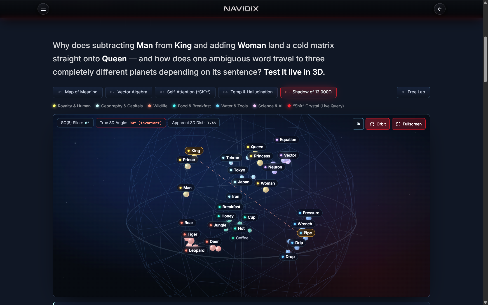
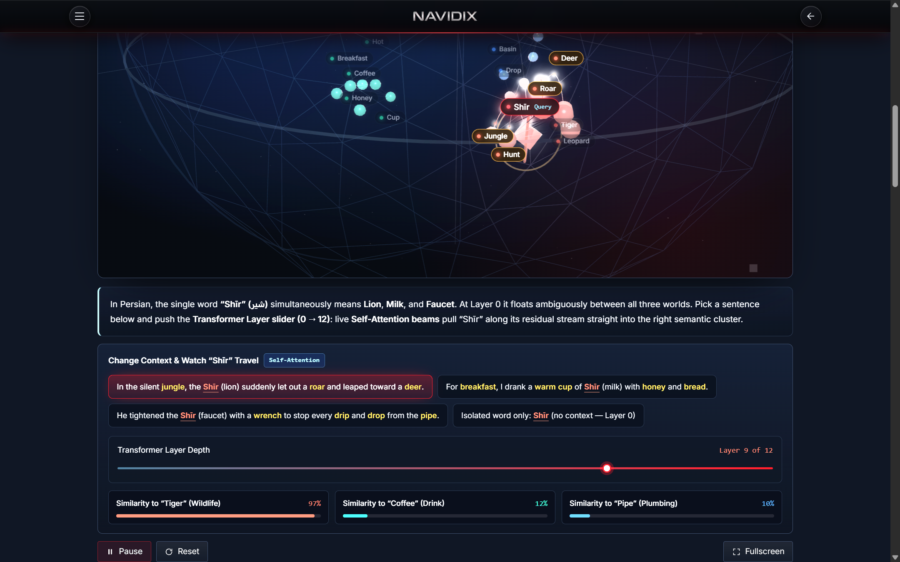
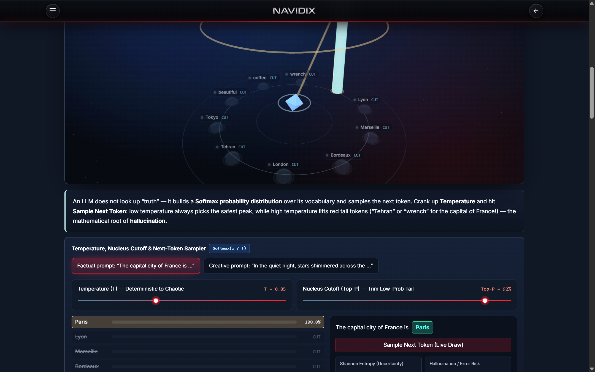

<div align="center">

# The Geometry of Meaning — 3D Interactive LLM Internals Lab

**How do Large Language Models "understand" without feeling? Explore live 8D word embeddings, semantic vector algebra (`King − Man + Woman = Queen`), multi-layer Self-Attention rays, Softmax Temperature & Top-P hallucination physics, and orthogonal `SO(8)` projections in 3D WebGL.**

[-navidixstudio.com-E31B23?style=for-the-badge)](https://navidixstudio.com/explore/geometry-of-meaning/?lang=en)
[](https://navidixstudio.github.io/geometry-of-meaning/)
[-38BDF8?style=for-the-badge)](https://navidixstudio.com/explore/geometry-of-meaning/?lang=en)
[](#run-locally-in-10-seconds)
[](./LICENSE)

*Part of [**Navidix Interactive Science Platform**](https://navidixstudio.com/explore/) · Built solo by [**Mohammad Navidi**](https://github.com/NavidixStudio).*

</div>

---

<p align="center">
  <a href="https://navidixstudio.com/explore/geometry-of-meaning/?lang=en">
    
  </a>
</p>

<table>
  <tr>
    <td width="50%" align="center">
      <a href="https://navidixstudio.com/explore/geometry-of-meaning/?lang=en&c=attention">
        
      </a>
      <br /><sub><b>Chapter 03:</b> Live Self-Attention rays disambiguating the Persian 3-way homonym <code>“Shīr”</code> (Lion / Milk / Faucet) across Transformer Layers 0→12</sub>
    </td>
    <td width="50%" align="center">
      <a href="https://navidixstudio.com/explore/geometry-of-meaning/?lang=en&c=temperature">
        
      </a>
      <br /><sub><b>Chapter 04:</b> Real-time <code>Softmax(z / T)</code>, Top-P nucleus cutoff, Shannon entropy, and live next-token hallucination sampler</sub>
    </td>
  </tr>
</table>

---

## Five Real Mathematical Chapters (Zero Pre-Baked Animations)

Every cosine similarity, parallelogram vector equation, scaled dot-product attention weight, Softmax distribution, Shannon entropy ($H = -\sum P \log_2 P$), perplexity ($2^H$), and `SO(8)` rotation is computed **live in the browser** — with instant **EN / FA** bilingual switching built directly into the top bar, hero, and 3D stage:

1. **01 · Map of Meaning (`8D Word Embeddings`):** Orbit 36 concepts clustered in an 8D unit-normalized semantic space projected to 3D. Click any word to open its live **8D Vector Fingerprint Inspector** and inspect exact cosine similarities `cos(θ)` and angles to its nearest neighbors and orthogonal opposites.
2. **02 · Vector Algebra (`King − Man + Woman = Queen`):** Visualize parallel linear directions in embedding space across gender, capitals (`Tehran − Iran + France = Paris`), and semantic roles.
3. **03 · Self-Attention & Polysemy (The `"Shīr / شیر"` Puzzle):** In Persian, `"شیر"` simultaneously means *Lion*, *Milk*, and *Water Faucet*. Scrub Transformer Layers **`0 → 12`** across 3 contexts and watch glowing Self-Attention beams pull the polysemous crystal along a curved residual-stream trajectory into the exact target cluster.
4. **04 · Temperature, Top-P & The Math of Hallucination:** Tune **`Temperature`** (`0.05 – 2.20`) and **`Top-P`** (`0.20 – 1.00`), watch real-time 3D probability towers, Shannon entropy, and perplexity update — and sample tokens live to witness exactly how flat high-temperature tails trigger confident hallucinations.
5. **05 · Shadow of 12,000 Dimensions (`SO(8)` Orthogonal Slice):** Rotate an 8D viewing slice continuously from `0°` to `90°` to see why unrelated words can appear close in 3D shadows while their true 8D angle remains nearly `90°`.

---

## Run Locally in 10 Seconds

Zero build step, zero npm dependencies, zero telemetry:

```bash
git clone https://github.com/NavidixStudio/geometry-of-meaning.git
cd geometry-of-meaning
npx serve .
```

- **English Default:** opens directly in English (`EN`) with a 1-click **`EN | فا`** switcher.
- **Hosted Live Demo (EN):** **[`navidixstudio.com/explore/geometry-of-meaning/?lang=en`](https://navidixstudio.com/explore/geometry-of-meaning/?lang=en)**
- **Hosted Live Demo (FA):** **[`navidixstudio.com/explore/geometry-of-meaning/?lang=fa`](https://navidixstudio.com/explore/geometry-of-meaning/?lang=fa)**
- **GitHub Pages Mirror:** **[`navidixstudio.github.io/geometry-of-meaning/`](https://navidixstudio.github.io/geometry-of-meaning/)**

---

<div dir="rtl" align="right">

## معرفی فارسی — هندسه‌ی معنا (هوش مصنوعی چطور بدون «فهمیدن» می‌فهمد؟)

این مخزن نسخه‌ی متن‌باز، مستقل و **دوزبانه (انگلیسی / فارسی)** از آزمایشگاه سه‌بعدی **«هندسه‌ی معنا»** در [پلتفرم علمی تعاملی استودیو نویدیکس](https://navidixstudio.com/explore/geometry-of-meaning/) است:

- **۵ فصل تعاملی با ریاضیات واقعی در مرورگر:** نقشه‌ی ۸بعدی واژگان و شباهت کسینوسی، جبر برداری معنا (`پادشاه − مرد + زن = ملکه`)، پرتوهای زنده‌ی `Self-Attention` روی کلمه‌ی چندمعنایی «شیر»، شبیه‌ساز `Temperature` و `Top-P` برای درک ریشه‌ی توهم هوش مصنوعی، و چرخش برش متعامد `SO(8)`.
- **تغییر زبان آنی:** با یک کلیک روی دکمه‌ی **`EN | فا`** کل رابط کاربری، برچسب‌های سه‌بعدی، تله‌متری و مقاله‌ی علمی به‌صورت لحظه‌ای بین انگلیسی و فارسی جابه‌جا می‌شوند.
- **دموی آنلاین فارسی:** [`navidixstudio.com/explore/geometry-of-meaning/`](https://navidixstudio.com/explore/geometry-of-meaning/)

</div>

---

## License

MIT © 2026 [Mohammad Navidi — Navidix Studio](https://navidixstudio.com)
